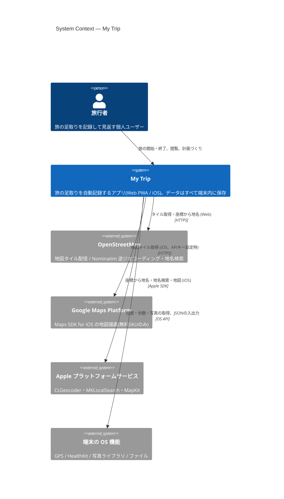
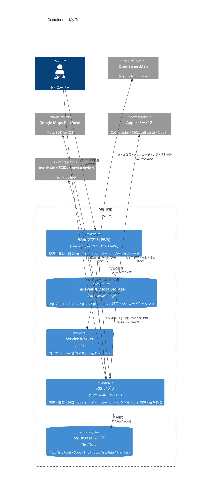
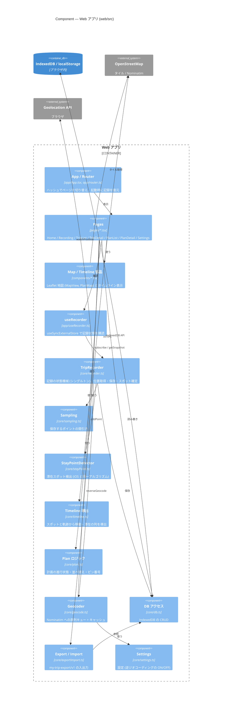
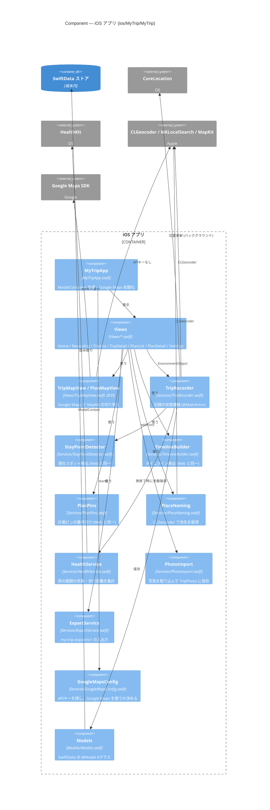
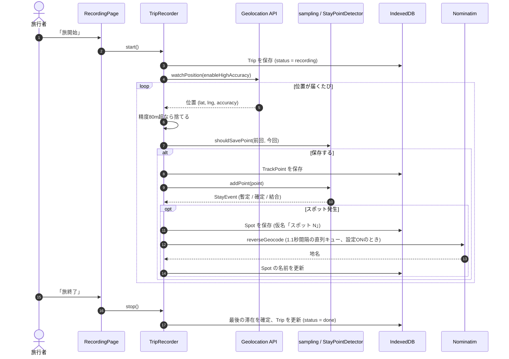
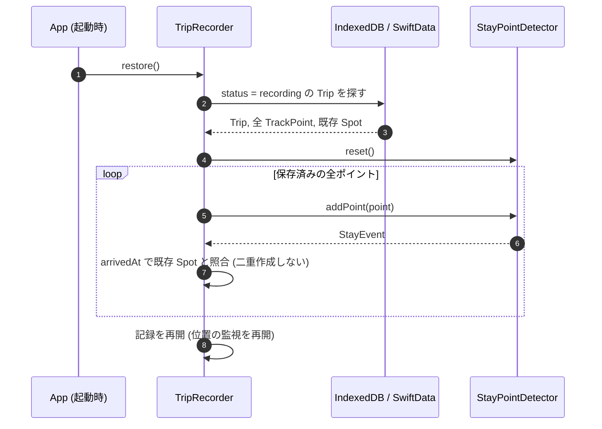
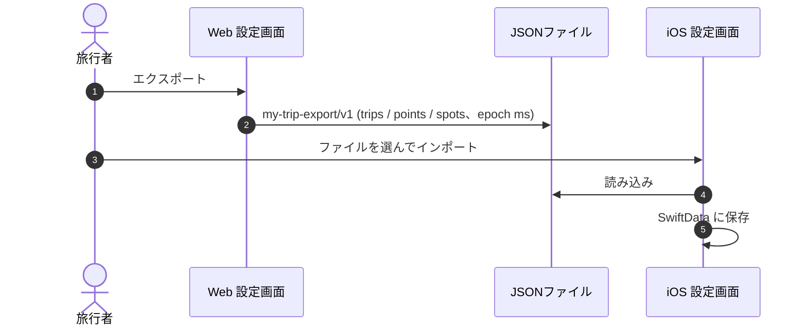

# My Trip — C4モデル アーキテクチャ図

> 本書はリポジトリのコード(2026-10時点の `main`)を調べて作った C4 モデルの図です。
> 設計の詳しい理由(滞在検出アルゴリズム・データモデル・プライバシー設計)は [02_architecture.md](02_architecture.md) を参照してください。
> コードで確認できなかった点は「未確認」と書いています。

## 1. 概要

### 目的

「旅開始」を押すだけで、訪れたスポット・移動の足取り・歩数(iOSのみ)を自動で記録し、旅の終了後に地図とタイムラインで見返せるパーソナル旅行ログです。旅の計画(行きたい場所のリスト)を作り、その計画から記録を始めることもできます。

### 主な利用者

| 利用者 | 説明 |
|---|---|
| 旅行者(エンドユーザー) | 自分の旅を記録して見返す個人。アカウントやログインはない(コード上に認証処理は存在しない) |

### 構成の特徴

- **サーバーなし・ローカルファースト**: バックエンドAPI・DB サーバー・認証基盤はありません。データはすべて端末内(Web: IndexedDB / iOS: SwiftData)に保存します。
- **2つの独立したクライアント**: Web版(React PWA)と iOS版(SwiftUI)は互いに通信しません。両者をつなぐのは、ユーザーが手動で受け渡すエクスポートJSON(`my-trip-export/v1`)だけです。
- **同一ロジックの二重実装**: 滞在検出(StayPointDetector)・タイムライン導出・ポイント間引き・計画ピンの番号付けは、Web と iOS で同じアルゴリズムを実装しています。
- **外部通信は無料サービスのみ**: 地図タイル(OSM / Google Maps SDK)、逆ジオコーディング・地名検索(Nominatim / Apple CLGeocoder・MKLocalSearch)。

### 技術スタック

| 区分 | Web版 (`web/`) | iOS版 (`ios/MyTrip/`) |
|---|---|---|
| 言語 | TypeScript 5.7 (strict) | Swift |
| UI | React 19 | SwiftUI(iOS 17.0以上) |
| ビルド | Vite 6(`@vitejs/plugin-react`) | Xcode 16(フォルダ同期形式) |
| ルーティング | ハッシュベースの自前ルータ(`src/app/router.ts`) | SwiftUI NavigationStack 等 |
| 状態管理 | `recorder.ts` のシングルトン + `useSyncExternalStore` | `TripRecorder`(`@MainActor` / `ObservableObject`) |
| 永続化 | IndexedDB(`idb` 8)、設定とジオコードキャッシュは `localStorage` | SwiftData(写真は `.externalStorage`) |
| 位置情報 | Geolocation API `watchPosition` | CoreLocation(Always許可、Background Modes: location) |
| 地図 | Leaflet 1.9 + OSMタイル | Google Maps SDK for iOS(SPM `ios-maps-sdk` 9.4以上)。APIキー未設定時は MapKit |
| 逆ジオコーディング / 地名検索 | OSM Nominatim `/reverse` `/search`(1.1秒間隔の直列キュー + キャッシュ) | CLGeocoder / MKLocalSearch |
| 健康データ | なし | HealthKit(歩数・歩行距離の読み取りのみ) |
| 写真 | なし | PhotosUI(`PhotosPicker`)で旅に添付 |
| PWA | 手書き `manifest.webmanifest` + `sw.js`(同一オリジンの静的アセットのみキャッシュ) | — |
| テスト | Vitest + fake-indexeddb(`src/core/*.test.ts`) | XCUITest(`MyTripUITests`) |

### インフラ・運用(確認結果)

| 項目 | 状態 |
|---|---|
| バックエンド / API サーバー | なし(コード上に存在しない) |
| データベースサーバー | なし(端末内DBのみ) |
| 認証 | なし |
| Docker / IaC(Terraform 等) | なし(リポジトリに該当ファイルがない) |
| CI(GitHub Actions 等) | なし(`.github/` ディレクトリがない) |
| Web版のホスティング先 | **未確認**。README には「GitHub Pages 等の静的ホスティングにそのままデプロイ可能」とあるが、デプロイ設定はリポジトリにない |
| iOS版の配信 | App Store(手順は [04_ios_distribution.md](04_ios_distribution.md))。実際に公開済みかは**未確認** |

---

## 2. Level 1: System Context 図



| 名前 | 種別 | 技術 | 責務 |
|---|---|---|---|
| 旅行者 | Person | — | 旅の記録の開始・終了、記録した旅の閲覧と編集、旅の計画づくり、データのエクスポート/インポート |
| My Trip | Software System | React PWA / SwiftUI | 位置を記録し、滞在スポットを自動検出して、地図とタイムラインで見せる。サーバーを持たず端末内で完結する |
| OpenStreetMap | External System | HTTPS(`tile.openstreetmap.org`, `nominatim.openstreetmap.org`) | Web版の地図タイル配信、逆ジオコーディング(`/reverse`)と地名検索(`/search`)。設定でジオコーディングをオフにできる |
| Google Maps Platform | External System | Google Maps SDK for iOS | iOS版の地図描画。APIキーを設定したときだけ使う(キーがなければ MapKit) |
| Apple プラットフォームサービス | External System | CLGeocoder / MKLocalSearch / MapKit | iOS版のスポット名の自動付与、計画の地名検索、Google Maps 未設定時の地図描画 |
| 端末の OS 機能 | External System | Geolocation API / CoreLocation / HealthKit / PhotosUI / ファイル入出力 | 位置情報・歩数・写真の取得。エクスポートJSONの保存と読み込み |

---

## 3. Level 2: Container 図



| 名前 | 種別 | 技術 | 責務 |
|---|---|---|---|
| Web アプリ (PWA) | Container(SPA) | TypeScript, React 19, Vite 6, Leaflet 1.9 | 記録・閲覧・計画の画面と、滞在検出などのドメインロジック。タブが前面にある間だけ記録できる(ブラウザの制約) |
| Service Worker | Container | `web/public/sw.js` | stale-while-revalidate で同一オリジンの静的アセットをキャッシュ。OSMタイルや Nominatim などクロスオリジンはキャッシュしない |
| IndexedDB / localStorage | Container(ブラウザ内DB) | `idb` 8(DB名 `my-trip`、v2) | IndexedDB に `trips`・`points`・`spots`・`plans`・`planItems` の5ストア。`localStorage` に設定(`my-trip-settings-v1`)と逆ジオコードのキャッシュ(`my-trip-geocode-cache-v1`) |
| iOS アプリ | Container(モバイルアプリ) | Swift, SwiftUI, iOS 17.0+ | 記録・閲覧・計画の画面とドメインロジック。バックグラウンドでの位置記録、HealthKit の歩数取得、写真の添付 |
| SwiftData ストア | Container(端末内DB) | SwiftData | `Trip`・`TripPoint`・`Spot`・`TripPhoto`・`TripPlan`・`PlanItem` の6モデル |
| エクスポートJSON | データ形式(コンテナ間の連携) | `my-trip-export/v1`(時刻は epoch ms) | Web⇔iOS で旅・軌跡・スポットを受け渡す唯一の手段。計画と写真は含めない |

> バッチ処理・メッセージキュー・オブジェクトストレージ・外部SaaSのDBは存在しません。

---

## 4. Level 3: Component 図

### 4.1 Web アプリ (PWA)



| 名前 | 種別 | 技術 | 責務 |
|---|---|---|---|
| App / Router | Component | `src/app/App.tsx`, `src/app/router.ts` | `#/trips/:id` などのハッシュを解析してページを選ぶ。起動時に `recorder.restore()` で中断した記録を復元(F-06) |
| Pages | Component(UI) | `src/pages/*.tsx` | 7画面。ホーム、記録中、旅一覧、旅詳細、計画一覧、計画詳細、設定 |
| Map / Timeline 部品 | Component(UI) | `src/components/MapView.tsx`, `PlanMap.tsx`, `Timeline.tsx` | Leaflet を直接操作する地図(react-leaflet は使わない)とタイムライン表示 |
| useRecorder | Component(Hook) | `src/app/useRecorder.ts` | `recorder` シングルトンの状態を React から購読する |
| TripRecorder | Component(ドメイン) | `src/core/recorder.ts` | `idle / starting / recording / error` の状態機械。精度80m超のポイントを捨て、間引き・滞在検出・スポット保存・名前付けを行う |
| Sampling | Component(純ロジック) | `src/core/sampling.ts` | 保存条件「10m以上 または 15秒以上」。8m/s 以上(乗り物移動)は30秒間隔 |
| StayPointDetector | Component(純ロジック) | `src/core/stayPoint.ts` | 半径80m・10分以上の滞在をスポットとして検出。120m以内は直前のスポットに結合 |
| Timeline 導出 | Component(純ロジック) | `src/core/timeline.ts` | 保存せず、表示時に移動/滞在のセグメントを導出する |
| Plan ロジック | Component(純ロジック) | `src/core/plan.ts` | 計画の進行状態(これから/期間中/過去)、表示順、地図ピンの番号付け |
| Geocoder | Component(外部連携) | `src/core/geocode.ts` | Nominatim の `/reverse` と `/search`。1.1秒間隔の直列キュー、約110m格子のキャッシュ |
| DB アクセス | Component(永続化) | `src/core/db.ts` | IndexedDB(`my-trip` v2)の CRUD |
| Export / Import | Component | `src/core/exportImport.ts` | 全データの JSON 書き出し(ダウンロード)と取り込み |
| Settings | Component | `src/core/settings.ts` | `localStorage` に設定を保存 |
| 共通の型・関数 | Component(図では省略) | `src/core/types.ts`, `geo.ts`, `format.ts` | ドメイン型、Haversine 距離・重心計算、表示用フォーマット |

### 4.2 iOS アプリ



| 名前 | 種別 | 技術 | 責務 |
|---|---|---|---|
| MyTripApp | Component(エントリポイント) | `MyTripApp.swift`(`@main`) | `ModelContainer` を作り、`TripRecorder` を環境に注入し、`GoogleMapsConfig.start()` を呼ぶ |
| Views | Component(UI) | `Views/*.swift`(SwiftUI) | ホーム、記録中、旅一覧/詳細、計画一覧/詳細、設定。計画の地名検索は `PlanDetailView` 内で `MKLocalSearch` を直接呼ぶ |
| TripMapView / PlanMapView | Component(UI) | `GoogleMaps`, `MapKit` | 同じ入力(軌跡・ピン・追従・フォーカス)で、Google Maps と MapKit を切り替えて描画 |
| TripRecorder | Component(ドメイン) | `Services/TripRecorder.swift`(`@MainActor`, `CLLocationManagerDelegate`) | バックグラウンドでの位置更新(`distanceFilter = 20`)、間引き(`shouldSave`)、滞在検出、スポットの名前付け、旅終了時の歩数取得 |
| StayPointDetector | Component(純ロジック) | `Services/StayPointDetector.swift` | Web 版 `stayPoint.ts` と同じアルゴリズム・同じパラメータ |
| TimelineBuilder | Component(純ロジック) | `Services/TimelineBuilder.swift` | Web 版 `timeline.ts` と同じタイムライン導出 |
| PlanPins | Component(純ロジック) | `Services/PlanPins.swift` | Web 版 `planPins` と同じ番号付けルール |
| PlaceNaming | Component(外部連携) | `Services/PlaceNaming.swift`(CLGeocoder) | 地図タップで登録した場所の名前を補完 |
| HealthService | Component(外部連携) | `Services/HealthService.swift`(HealthKit) | 旅の期間の歩数・歩行距離を読み取る(書き込みはしない) |
| PhotoImport | Component | `Services/PhotoImport.swift`(PhotosUI) | 写真を旅に添付(エクスポート対象外) |
| ExportService | Component | `Services/ExportService.swift` | `my-trip-export/v1` の書き出し(共有シート)と取り込み(`fileImporter`) |
| GoogleMapsConfig | Component(設定) | `Services/GoogleMapsConfig.swift` | `Secrets.plist` → `Info.plist` → 環境変数 `GOOGLE_MAPS_API_KEY` の順にキーを探す |
| Models | Component(永続化) | `Models/Models.swift`(SwiftData) | `Trip`・`TripPoint`・`Spot`・`TripPhoto`・`TripPlan`・`PlanItem` |

---

## 5. 主要なデータフロー

### 5.1 旅の記録(位置取得 → 滞在検出 → スポット命名)

Web 版のコード(`core/recorder.ts`)に沿った流れです。iOS 版も同じ流れで、Geolocation が CoreLocation に、Nominatim が CLGeocoder に、IndexedDB が SwiftData に置き換わります。



### 5.2 中断した記録の復元(F-06)



検出器が決定的(同じ入力なら同じ出力)であることを前提にした方式です。

### 5.3 Web ⇔ iOS のデータ移行



逆方向(iOS → Web)も同じ形式です。計画と写真はエクスポートに含まれません。

---

## 6. ディレクトリ構成

```
my-trip/
├── README.md                     # 概要・起動方法
├── CLAUDE.md                     # 開発ガイド(制約・開発フロー)
├── docs/
│   ├── 01_requirements.md        # 要件定義書
│   ├── 02_architecture.md        # アーキテクチャ設計書(アルゴリズム・データモデル)
│   ├── 03_screens.md             # 画面設計書・デザイントークン
│   ├── 04_ios_distribution.md    # App Store 配信手順
│   └── architecture.md           # 本書(C4モデル図)
├── web/                          # Web版 (React PWA)
│   ├── index.html                # エントリHTML(manifest・アイコン)
│   ├── package.json              # 依存定義・npm スクリプト
│   ├── vite.config.ts            # Vite / Vitest 設定(ポート 5173)
│   ├── tsconfig.json
│   ├── public/                   # manifest.webmanifest, sw.js, アイコン
│   └── src/
│       ├── main.tsx              # エントリポイント(React 描画・SW 登録)
│       ├── styles.css            # スタイル(デザイントークン)
│       ├── app/                  # App・ハッシュルータ・useRecorder
│       ├── pages/                # 画面(7ページ)
│       ├── components/           # 地図 (Leaflet)・タイムライン
│       └── core/                 # React に依存しない純ロジック + DB + 外部連携(テスト対象)
├── ios/MyTrip/                   # iOS版 (SwiftUI)
│   ├── MyTrip.xcodeproj          # Xcode プロジェクト(SPM: googlemaps/ios-maps-sdk)
│   ├── MyTrip/
│   │   ├── MyTripApp.swift       # エントリポイント (@main)
│   │   ├── Info.plist            # Background Modes: location など
│   │   ├── MyTrip.entitlements   # HealthKit
│   │   ├── Secrets.example.plist # Google Maps APIキーのひな形(実体の Secrets.plist は .gitignore)
│   │   ├── Models/               # SwiftData モデル
│   │   ├── Services/             # 記録・検出・ジオコード・HealthKit・エクスポートなど
│   │   ├── Views/                # SwiftUI 画面・地図
│   │   └── Assets.xcassets       # アイコン・アクセントカラー
│   └── MyTripUITests/            # XCUITest(記録開始〜終了・写真添付のフロー)
└── .claude/                      # Claude Code 設定と UI 系スキル
```
